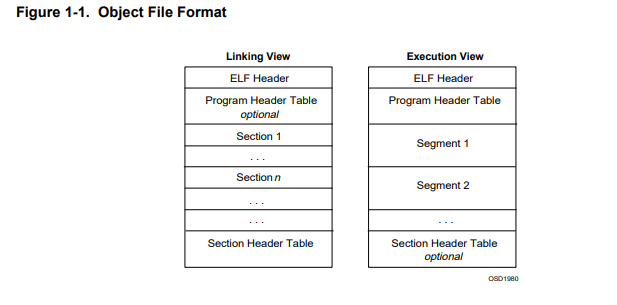

# Prog5Projet

## Setting up
- Make sure you have gcc-arm-none-eabi installed or have any sorta environment to run idk.
- **Extract the tar.gz**: `tar -xvzf student_elf_linker-1.0.tar.gz`
- In the `cd` into `code_fourni/elf_linker-1.0`, run `./configure && make && make install`. You are probably going to need root permission.
- Alternatively, execute each command directly, here is a plagiarized section from the `INSTALL`:
```
 The simplest way to compile this package is:

  1. `cd' to the directory containing the package's source code and type
     `./configure' to configure the package for your system.

     Running `configure' might take a while.  While running, it prints
     some messages telling which features it is checking for.

  2. Type `make' to compile the package.

  3. Optionally, type `make check' to run any self-tests that come with
     the package, generally using the just-built uninstalled binaries.

  4. Type `make install' to install the programs and any data files and
     documentation.  When installing into a prefix owned by root, it is
     recommended that the package be configured and built as a regular
     user, and only the `make install' phase executed with root
     privileges.

  5. Optionally, type `make installcheck' to repeat any self-tests, but
     this time using the binaries in their final installed location.
     This target does not install anything.  Running this target as a
     regular user, particularly if the prior `make install' required
     root privileges, verifies that the installation completed
     correctly.

  6. You can remove the program binaries and object files from the
     source code directory by typing `make clean'.  To also remove the
     files that `configure' created (so you can compile the package for
     a different kind of computer), type `make distclean'.  There is
     also a `make maintainer-clean' target, but that is intended mainly
     for the package's developers.  If you use it, you may have to get
     all sorts of other programs in order to regenerate files that came
     with the distribution.

  7. Often, you can also type `make uninstall' to remove the installed
     files again.  In practice, not all packages have tested that
     uninstallation works correctly, even though it is required by the
     GNU Coding Standards.

  8. Some packages, particularly those that use Automake, provide `make
     distcheck', which can by used by developers to test that all other
     targets like `make install' and `make uninstall' work correctly.
     This target is generally not run by end users.
```

Containing in `Options_and_debug_example.c` is a program collecting 2 options `--option1` and `--option2`. Give it a read.

In `elf_linker-1.0` are examples of a case of fusion. I'd try to use `arm-none-eabi-readelf -h` on one of the `.o`. Maybe try exploring there.
## Exploring the project
### Phase 1
`arm-none-eabi-readelf -h file1.o` gives the following header as output:
```
ELF Header:
  Magic:   7f 45 4c 46 01 02 01 00 00 00 00 00 00 00 00 00 
  Class:                             ELF32
  Data:                              2's complement, big endian
  Version:                           1 (current)
  OS/ABI:                            UNIX - System V
  ABI Version:                       0
  Type:                              REL (Relocatable file)
  Machine:                           ARM
  Version:                           0x1
  Entry point address:               0x0
  Start of program headers:          0 (bytes into file)
  Start of section headers:          1376 (bytes into file)
  Flags:                             0x5000000, Version5 EABI
  Size of this header:               52 (bytes)
  Size of program headers:           0 (bytes)
  Number of program headers:         0
  Size of section headers:           40 (bytes)
  Number of section headers:         23
  Section header string table index: 22
```
The objectif right now is to comprehend how it is represented in the binary form, thus studying `elf.pdf` is necessary. 

there are three main types of object files
• A relocatable file 
• An executable file 
• A shared object file


An object file can be seen from to sides linking view and execution view (figure 1-1).

The linking view is used for linking relocatable files and for debugging, because it is based on sections.
The execution view is used by the OS loader and the dynamic linker to map segments of executables and shared objects into memory.
(sections and segments to be explained later)


AN ELF Header is pretty much what let's you know how an elf file is organized (size,small or big endian endoding all that stuff detail in the elf.pdf)
The following contains the definition of an ELF header, cited from `elf.pdf`
```
typedef struct {
    unsigned_char   e_ident[EI_NIDENT]; 
    Elf32_Half      e_type;
    Elf32_Half      e_machine;
    Elf32_Word      e_version;
    Elf32_Addr      e_entry;
    Elf32_Off       e_phoff;
    Elf32_Off       e_shoff;
    Elf32_Word      e_flags;
    Elf32_Half      e_ehsize;
    Elf32_Half      e_phentsize;
    Elf32_Half      e_phnum;
    Elf32_Half      e_shentsize;
    Elf32_Half      e_shnum;
    Elf32_Half      e_shstrndx;
} Elf32 Ehdr;
```
Further descriptions of each type is of course, within the documents and will not be included here. The purpose is to summarize key information so further relecture won't take as much time.


*To note: the `e_machine` code for ARM type machine is not included in the doc, consult probably the complement doc*
         *e_ident always starts at 0*
### Phase 2: 

## Section Header Table

After parsing the ELF header, the next step is to read the **Section Header Table**, which describes all sections present in the file.  
Using the fields `e_shoff`, `e_shnum`, and `e_shentsize` from `Elf32_Ehdr`, we can locate the table in the binary and iterate over each `Elf32_Shdr` entry.

Section definition from the pdf:
```

typedef struct {
   Elf32_Word sh_name;
   Elf32_Word sh_type;
   Elf32_Word sh_flags;
   Elf32_Addr sh_addr;
   Elf32_Off sh_offset;
   Elf32_Word sh_size;
   Elf32_Word sh_link;
   Elf32_Word sh_info;
   Elf32_Word sh_addralign;
   Elf32_Word sh_entsize;
} Elf32_Shdr;
```

Each `Elf32_Shdr` provides metadata about a section (type, size, file offset, flags, etc.), but **does not store the section name directly**.  
Instead, the `sh_name` field is an offset into the **section header string table** (`.shstrtab`).

The index of `.shstrtab` is given by `e_shstrndx`. Once this section is located and read, section names can be resolved by interpreting each `sh_name` as an offset into `.shstrtab`.

This phase allows us to identify and name all sections, such as `.text`, `.data`, `.bss`, `.symtab`, and prepares the ground for symbol and relocation analysis.

More details in the pdf obviously.

### Phase 3:

## Identifying and Interpreting Key Sections

Once all section headers are read and section names resolved, the next step is to **identify sections that are semantically important for linking and execution**. (to be continued) 


At this stage, the goal is not to process their contents yet, but to **classify sections by role** using their `sh_type`, `sh_flags`, and resolved names.

Key sections of interest include:
- `.text`: executable instructions (machine code)
- `.data`: initialized global and static variables (`.data` and `.text` are the same ones we saw in INF401, but of course in binary form, not ARM) 
- `.bss`: uninitialized data (type `SHT_NOBITS`, occupies no file space)
- `.rodata`: read-only data (constants, literals)
- `.symtab`: symbol table used by the linker
- `.strtab`: string table for symbol names
- `.rel.*` / `.rela.*`: relocation entries associated with sections

For each section, we record:
- its index in the section header table
- its name
- its type (`sh_type`)
- its file offset (`sh_offset`)
- its size (`sh_size`)

This classification step determines **which sections must be parsed in later phases** (symbols and relocations) and which can be ignored for the current scope.

